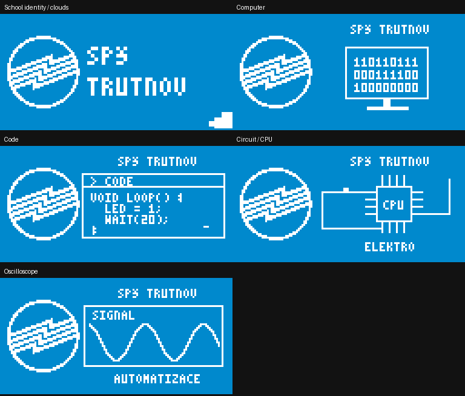
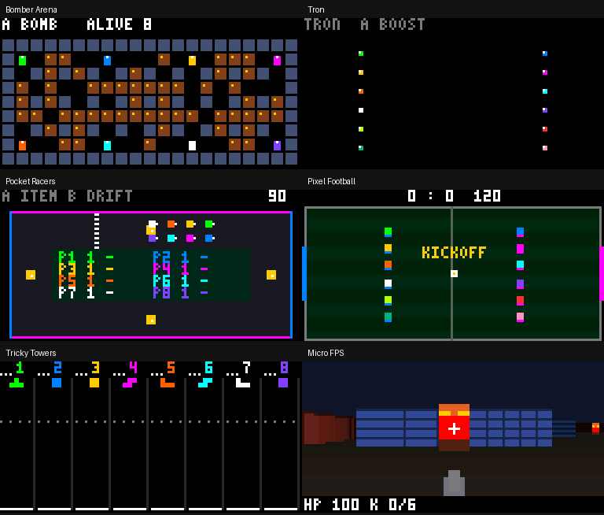

# HubGames

Games for two daisy chained 64x64 HUB75 panels driven by an RP-HUB75 board, controlled by a Saturn (ESP32-S3) board.

RP-HUB75 must run the firmware built with QSPI input (`RoboCamp/RP-HUB75/sw/fw`).

## Wiring (Saturn J6 -> RP-HUB75)

| Signal | ESP32-S3 |
|---|---|
| D0  | IO38 |
| D1  | IO39 |
| D2  | IO41 |
| D3  | IO45 |
| CS  | IO1  |
| CLK | IO3  |

## Build and flash

```sh
. ~/esp/esp-idf-v5.5.1/export.sh
python3 tools/update_network_config.py
idf.py build flash monitor
```

Flashing goes over native USB (USB-Serial-JTAG), no boot button needed.

## Doom

Full DOOM from upstream is preserved as an optional PSRAM/WAD build; see the full DOOM instructions below. Its phone layout switches automatically.


## Playing

Connect a phone to the open WiFi `HubGames` and open `http://192.168.4.1`. Up to 12 phones get P1-P12 in connect order.
P1 picks in the main menu: 1 PLAYER, VERSUS (own panel each), PARTY (shared screen, game-specific limits), AMBIENT (14 effects), SPŠ TRUTNOV (school identity show), or SETTINGS (2 or 4 panels, brightness, panel test).
With nobody connected the panels run the ambient show with join info. 4 panels = 2x2, chain order in `panel_map` in `main/hub75.c`.

## New games on the current two-panel 128×64 setup

| Game | Players | Controls |
|---|---|---|
| Bomber Arena | 2–8 | Directions move; A drops a bomb. Upgrades, chain reactions, closing walls. |
| Tron | 2–12 | Directions turn; hold A to boost. Trails remain dangerous. |
| Pocket Racers | 2–8 | Left/right steer; A uses an item; hold B while turning to drift. Automatic throttle. |
| Pixel Football | 2–12 | Directions/stick move; A kicks; hold B to sprint. Alternating entrants form balanced teams. |
| Tricky Towers | 2–8 | Left/right move; A rotates; B drops; down soft-drops. Build to the dotted line. |
| Micro FPS | 1 in regular firmware; 2 in per-panel versus | Stick moves and turns; hold A to shoot; hold B for strafing. |
| Party Cup | 2–12 | Five random eligible shared games. A advances between rounds. Win: 3 points; others: 1. |

Games with a limit of eight use the first eight connected slots; the menu shows
`8/12 PLAYERS` when four additional controllers will sit out. Party Cup preserves
its starting roster and picks only games that fit the whole group. Individual
VERSUS games still use one physical panel per participant (two now, up to four).
Snake Arena and Pong also accept twelve players. Every slot has a unique RGB565
color; that exact color is sent to the phone along with its game-specific button
labels. Switching apps, cancelling touch, or switching stick/arrows clears input.

Tricky Towers is a simple grid-based approximation: rigid tetrominoes slide off
narrow supports, overhanging pieces can fall out, rows never clear, and each player
has three lives. It does not simulate free rotation or a full rigid-body world.
Micro FPS is original raycasting code with six enemies, assisted hitscan aiming,
wall occlusion and an exit in the southeast corner after all enemies are defeated.
See [the ESP DOOM port research](games/micro-fps.md).

The school show uses the official logo from the school website, rasterized ahead
of time, with only school blue #008ACC and white. Scenes: clouds and identity,
computer, typing code, circuit/CPU, oscilloscope. [Artwork source and attribution](../main/assets/README.md).

Pixel-exact 128×64 previews from the real C renderer:





## Network and performance

ESP32-S3 / ESP-IDF 5.5.1 supports twelve AP clients with the ESP-NOW key reservation
reduced to two. The project sets WiFi capacity to 12, DHCP leases to 12, TCP sockets
to 20 and HTTP client sockets to 14. Expired controllers release both their player
slot and their server socket. Existing builds must run the config update above:
ESP-IDF defaults alone do not override a previously generated `sdkconfig`.

The loop remains 50 Hz. New games use fixed-point/integer calculations, static
state and no per-frame allocations. Shared state overlaps compact per-panel state
buffers, saving 28 KiB compared with four 16 KiB buffers. Single Snake occupancy
uses a bitset. Opaque games skip the plasma background; only visible framebuffer
rows are cleared. Joystick traffic is coalesced to 50 Hz, with immediate button
changes and a 10 Hz heartbeat. Logs every ten seconds include worst frame time,
over-budget frames and current/minimum free heap for checking actual hardware.

## Verification

```sh
./tools/test_host.sh
# Workaround for the Apple ASan startup issue on the development machine:
HOST_SANITIZERS=undefined,bounds,object-size ./tools/test_host.sh
```

Host checks exercise the real game/menu/drawing code, snake corpse collisions,
FPS walls and shooting, all twelve slots and reconnects, unique colors, cup
rosters, all 14 ambient effects, and the exact school color palette at both
64- and 128-pixel heights. Run the checks and ESP-IDF 5.5.1 firmware builds
locally using the commands above. ESP calls in the network host test are fakes;
radio capacity and frame timings still require the actual board and twelve phones.

## Code

- `main/main.c` - game loop (20 ms), menus, pause, results
- `main/net.c` - WiFi AP, HTTP page, WebSocket input, player slots
- `main/gfx.c` - drawing + 3x5 font into `hub75_fb[y][x]` (RGB565), sent by `hub75_show()`
- `main/fx.c` - particles, `main/ambient.c` - plasma and attract show, `main/settings.c` - NVS settings
- `main/games/` - games implementing `game_t` from `game.h`
- `main/web/index.html` - controller page

Design: `docs/plan.md`, `docs/plan-v2.md`, per game `docs/games/`.

### Upstream Tanky a plný DOOM

Větev zachovává novější Tanky i port doomgeneric z `C2Coder/HubGames`.
Tanky podporují 2–8 hráčů v aréně (tři vítězná kola) nebo singleplayer proti AI;
A střílí. Masky, barvy a rozložení skóre fungují i pro připojené sloty P9–P12.

Singleplayer nabízí jednu variantu podle sestavení: výchozí MICRO FPS bez PSRAM
a WAD, nebo plný DOOM při zapnutém `CONFIG_HUBGAMES_FULL_DOOM`. V sestavení s
plným DOOMem zůstává MICRO FPS pouze ve VERSUS pro nezávislé panely.
Plný DOOM je volitelný pro ESP32-S3 s octal PSRAM; jeho zdrojový port a WAD partition
zůstávají v repozitáři. Nové sestavení s PSRAM:

```sh
git submodule update --init --recursive
idf.py -B build-doom -D SDKCONFIG=sdkconfig.doom -D 'SDKCONFIG_DEFAULTS=sdkconfig.defaults;sdkconfig.defaults.doom' build
idf.py -B build-doom -D SDKCONFIG=sdkconfig.doom flash
./doom/get-wad.sh
./doom/flash-wad.sh /dev/ttyACM0
idf.py -B build-doom -D SDKCONFIG=sdkconfig.doom monitor
```

Cestu sériového portu upravte podle zařízení. Plný DOOM převzal upstream GPL-2.0
engine; telefon automaticky zobrazí joystick pro pohyb a úkroky, samostatné
větší šipky pro otáčení, FIRE nad nimi a USE pod nimi. START otevírá menu DOOMu. Ukončení DOOMu rebootuje
zařízení, stejně jako původní upstream. Mikro FPS zůstává samostatná malá hra.
